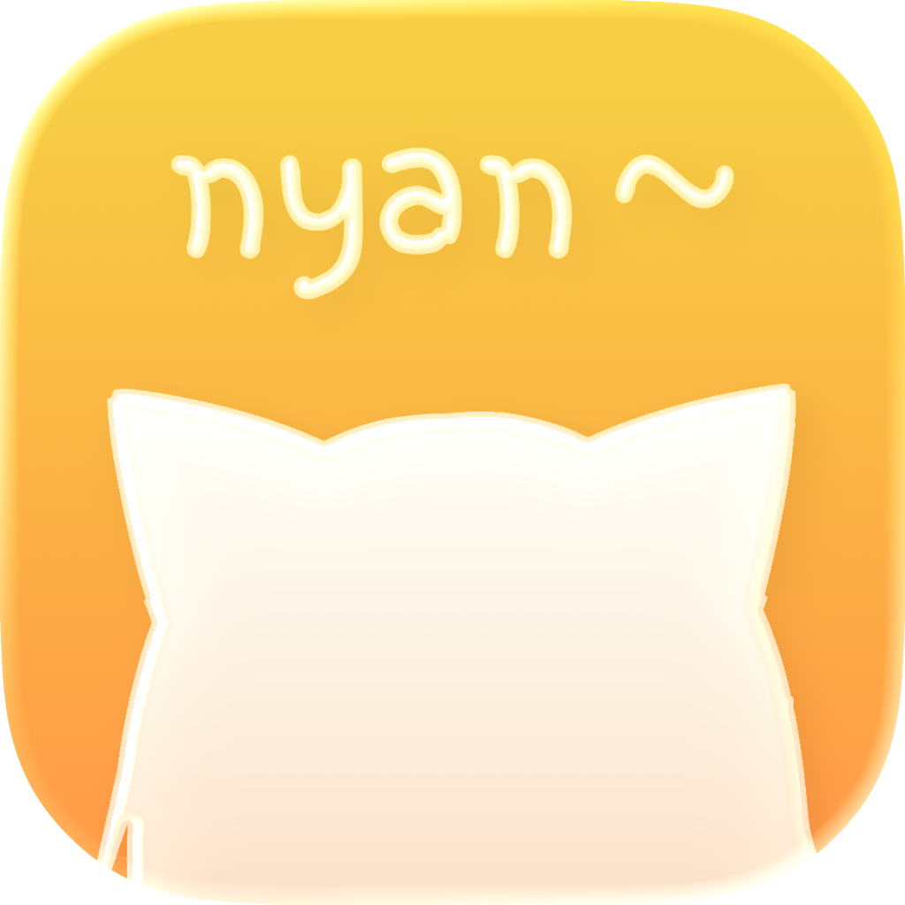
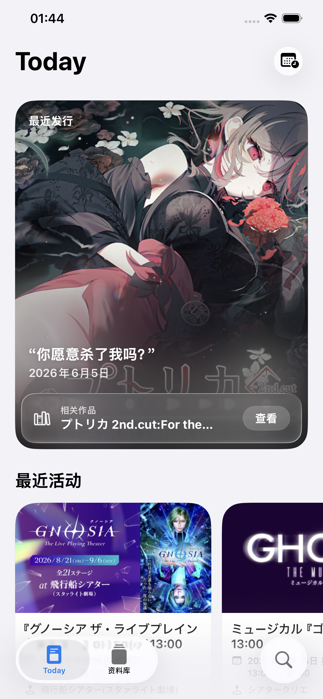
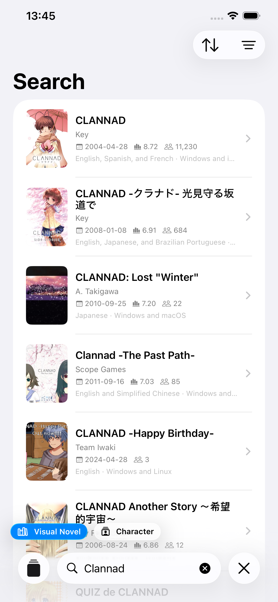
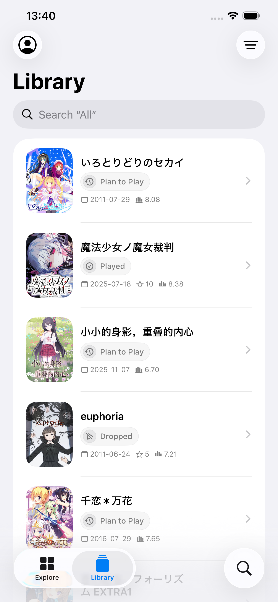
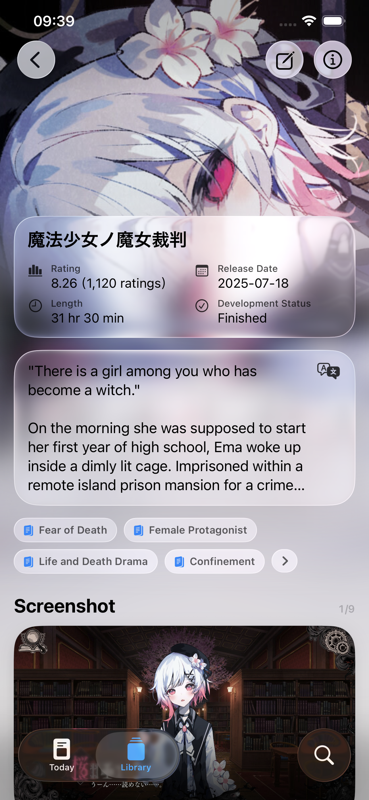

  <a href="./README.md">English</a> ·
  <a href="./README.zh-Hans.md">简体中文</a> ·
  <a href="./README.zh-Hant.md">繁體中文</a> ·
  <strong>日本語</strong> ·
  <a href="./README.ko.md">한국어</a>

<h1 align="center">
  
  PaperVN
</h1>

  <strong>ビジュアルノベルを記録・発見</strong>

PaperVNはAppleデバイス向けに設計されたビジュアルノベル支援アプリです。作品との出会い、作品やキャラクターへの理解、プレイ履歴の記録を一つにまとめます。サインインしなくても、VNDBの公開データを閲覧・探索・検索できます。VNDBアカウントにサインインすると、自分のライブラリを読み取り、編集することもできます。

## プレビュー

  
  
  
  

Today・検索・ライブラリ・ビジュアルノベル詳細

## 説明

### 軽やかに

PaperVNは制作を通して、常に「美しさを優先する」という原則を大切にしてきました。すべてSwiftUIで構築し、細部まで丁寧に検討しています。

### Today

Todayでは、注目してほしいビジュアルノベルや最近のイベントを毎日紹介します。また、PaperVNはライブラリの内容を分析し、機械学習を使って「あなたへのおすすめ」リストを生成します。

### ライブラリ

VNDBアカウントにログインすると、ライブラリの編集、プレイ状況、プレイしたリリース、評価、開始日・終了日の更新ができます。言語、外観、コンテンツセーフティなどの設定も自由に変更できます。

### ビジュアルノベル／キャラクター詳細

PaperVNでは、VNDBにある6,000件以上のビジュアルノベルタグとキャラクター特性をローカライズし、簡体字中国語、繁体字中国語、英語、日本語、韓国語に対応しています。さらに、VNDBに登録されている20万件以上のビジュアルノベルとキャラクターの紹介文についても、ローカライズ対応を進めています。

### 検索

ビジュアルノベル、キャラクター、リリース、スタッフ、開発元、発売元を検索でき、条件に一致するよう結果を絞り込めます。

### 動作環境

iOS 26以降を搭載したiPhone、またはiPadOS 26以降を搭載したiPadが必要です。

### ライセンス

特に記載がない限り、PaperVNの開発者が提供するデータは、[CC0 1.0 Universal](https://creativecommons.org/publicdomain/zero/1.0/deed.ja)に基づく自由コンテンツです。
