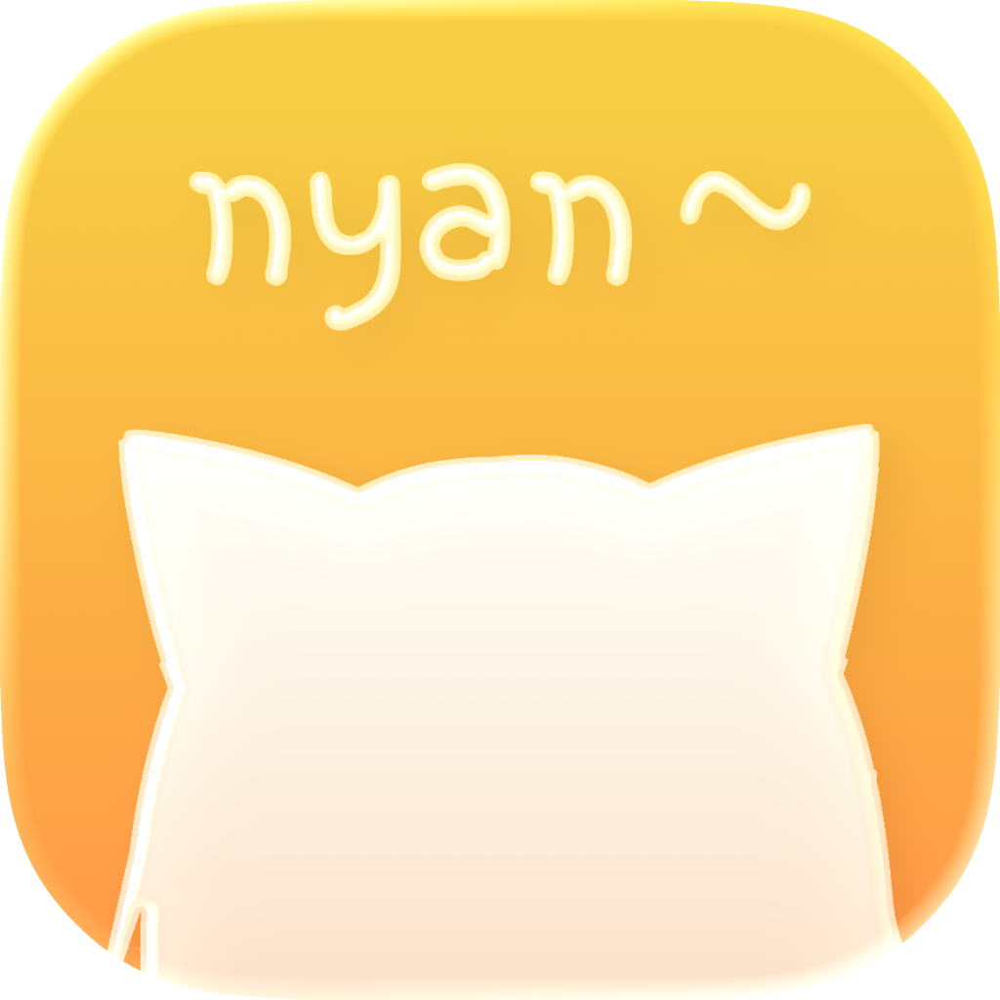
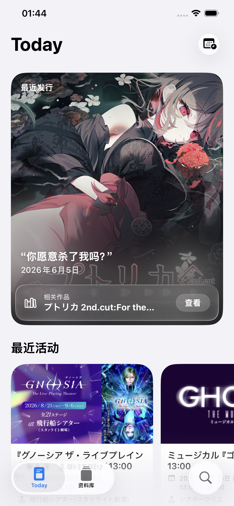
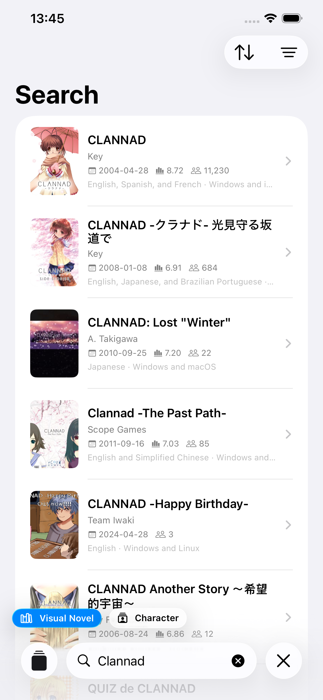
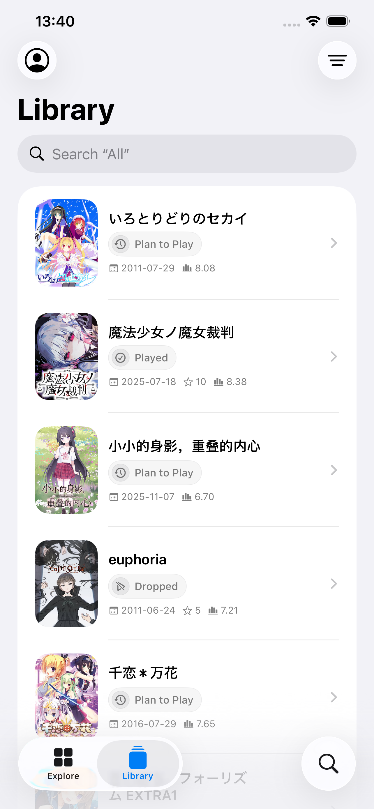
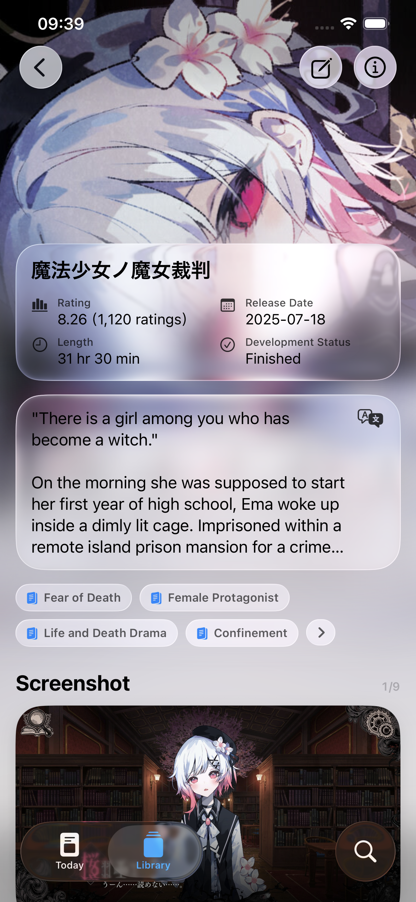

  <a href="./README.md">English</a> ·
  <a href="./README.zh-Hans.md">简体中文</a> ·
  <a href="./README.zh-Hant.md">繁體中文</a> ·
  <a href="./README.ja.md">日本語</a> ·
  <strong>한국어</strong>

<table>
  <tr>
    <td></td>
    <td width="32"></td>
    <td align="left">
      <h1>PaperVN</h1>
      
<strong>비주얼 노벨 기록과 발견</strong>

    </td>
  </tr>
</table>

PaperVN은 Apple 기기를 위해 만든 비주얼 노벨 도우미입니다. 비주얼 노벨을 발견하고 작품과 캐릭터를 깊이 이해하며, 모든 플레이 여정을 기록할 수 있습니다. 로그인하지 않아도 VNDB의 공개 데이터를 둘러보고 탐색하고 검색할 수 있습니다. VNDB 계정에 로그인하면 개인 보관함을 읽고 편집할 수도 있습니다.

## 미리 보기

  
  
  
  

Today · 검색 · 보관함 · 비주얼 노벨 상세

## 설명

### 가볍게

PaperVN은 제작 과정에서 항상 “아름다움 우선”이라는 원칙을 지켜 왔습니다. 전체 앱을 SwiftUI로 만들었으며, 모든 세부 요소를 세심하게 고려했습니다.

### Today

Today는 매일 주목할 만한 비주얼 노벨과 최근 이벤트를 소개합니다. 또한 PaperVN은 보관함 내용을 분석하고 머신 러닝을 사용해 “추천” 목록을 생성할 수 있습니다.

### 보관함

VNDB 계정에 로그인하면 보관함을 편집하고 플레이 상태, 플레이한 출시 버전, 평점, 시작일과 종료일을 업데이트할 수 있습니다. 언어, 화면 표시, 콘텐츠 안전 등의 환경설정도 자유롭게 변경할 수 있습니다.

### 비주얼 노벨／캐릭터 상세

PaperVN은 VNDB의 비주얼 노벨 태그와 캐릭터 특성 6,000개 이상을 현지화했으며, 중국어 간체, 중국어 번체, 영어, 일본어, 한국어를 지원합니다. 또한 VNDB에 등록된 비주얼 노벨과 캐릭터 소개 20만 개 이상의 현지화도 진행하고 있습니다.

### 검색

비주얼 노벨, 캐릭터, 출시 버전, 제작진, 개발사, 배급사를 검색하고 일치 조건 필터로 결과를 좁힐 수 있습니다.

## 시스템 요구 사항

iOS 26 이상이 설치된 iPhone 또는 iPadOS 26 이상이 설치된 iPad가 필요합니다.

## 라이선스

별도 표기가 없는 한 PaperVN 개발자가 제공하는 데이터는 [CC0 1.0 Universal](https://creativecommons.org/publicdomain/zero/1.0/deed.ko)에 따라 공개된 자유 콘텐츠입니다.

## Apple 용어집

PaperVN의 인터페이스 문구는 7개 언어 모두 Apple의 용어를 따릅니다. 번역을 추가하거나 수정하기 전에 [Apple 용어집](./README.zh-Hans.md#apple用语术语表)을 확인하십시오. 본문은 중국어 간체로 작성되어 있지만 표에는 모든 언어가 포함되어 있습니다.
