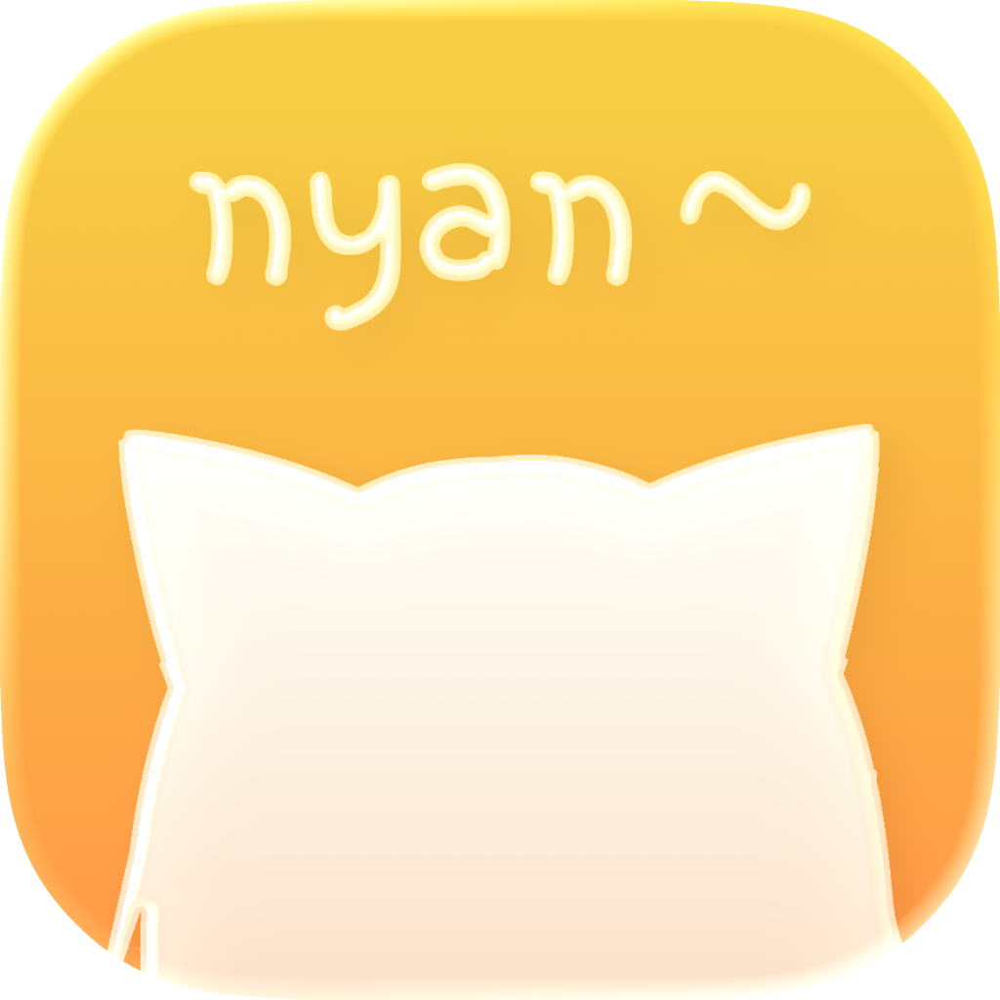
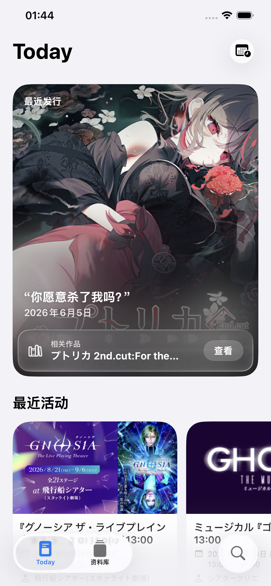
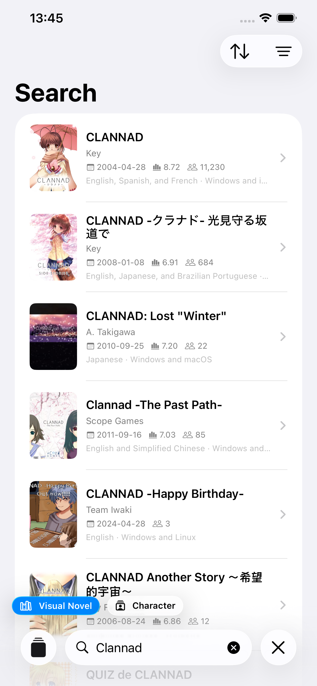
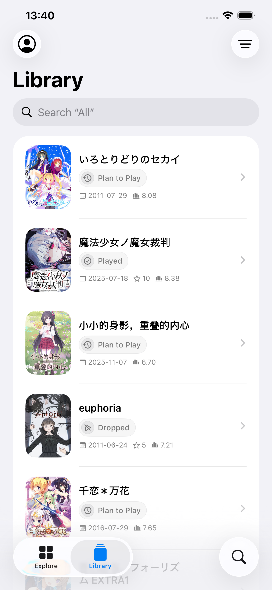
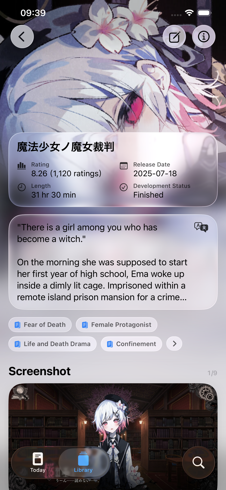

  <a href="./README.md">English</a> ·
  <strong>简体中文</strong> ·
  <a href="./README.zh-Hant.md">繁體中文</a> ·
  <a href="./README.ja.md">日本語</a> ·
  <a href="./README.ko.md">한국어</a>

<table>
  <tr>
    <td></td>
    <td width="32"></td>
    <td align="left">
      <h1>PaperVN</h1>
      
<strong>追踪与发现视觉小说</strong>

    </td>
  </tr>
</table>

PaperVN 是一款为 Apple 设备打造的视觉小说辅助工具，帮助你发现视觉小说、深入了解作品与角色，并记录每一段游玩旅程。无需登录即可浏览、探索和搜索 VNDB 的公开数据。登录 VNDB 账号后，还可以读取和编辑个人资料库。

## 预览

  
  
  
  

Today · 搜索 · 资料库 · 视觉小说详情

## 描述

### 轻轻地来

PaperVN 在制作过程中始终坚持“美观优先”的原则。完全使用 SwiftUI 制作，每一处细节都经过仔细考虑。

### Today

Today 每天都会展示一些值得关注的视觉小说与近期活动。同时，PaperVN 还能分析你的资料库内容，并使用机器学习生成“为你推荐”列表。

### 资料库

登录 VNDB 账号后，你可以编辑资料库、更新游玩状态、游玩版本、评分以及开始或结束日期。语言、外观与内容安全等偏好也都可以自定义。

### 视觉小说／角色详情

PaperVN 已为 VNDB 中 6,000 多个视觉小说标签与角色特征提供本地化，支持简体中文、繁体中文、英语、日语与韩语。我们还正在为 VNDB 中 20 多万个视觉小说与角色简介提供本地化支持。

### 搜索

支持搜索视觉小说、角色、发行版本、制作人员、开发商与发行商，并可使用匹配条件进一步筛选结果。

## 系统要求

需要运行 iOS 26 或更高版本的 iPhone，或运行 iPadOS 26 或更高版本的 iPad。

## 协议

除非另有说明，PaperVN 开发者提供的数据均为遵循 [CC0 1.0 通用协议](https://creativecommons.org/publicdomain/zero/1.0/deed.zh-hans)的自由内容。

## Apple用语术语表

PaperVN 的界面文案照 Apple 自己的用词写，七种语言都是。新增或修改文案前先查这张表；表里没有的词，到系统 App 里看同类的地方怎么写。繁体中文照 Apple 台湾的用词（例如“分享”“開啟”），不从简体直接转换。

**以 iOS 为准。** PaperVN 是 iPhone App，表里的统计来自 Xcode 的 iOS 27.1 模拟器运行时（所有系统 App 与框架，和 iPhone 上的本地化文件相同）：367,367 条字符串，按简中、繁中、英、日、韩、德、波兰语对齐。本机 macOS 26.7“系统设置”的 17,119 条作为参考，两边不一样时照 iOS（例如 macOS 用“存储”“载入”，iOS 用“保存”“加载”）。

### 简体中文

#### 用词

| 用这个 | 不用这个 | 例子 |
|---|---|---|
| 所有（+名词） | 全部（+名词） | 所有平台、所有类型、所有地区、所有标签 |
| 全部（单独作筛选项，或作副词） | — | 筛选菜单里的“全部”、“全部使用…” |
| 轻点 | 点击、单击、点按（说明文字里） | 轻点下方的类别试试 |
| 按住 | 长按 | 按住即可拷贝 |
| 轻扫 | 滑动、上拉、下拉（指引里） | 向上轻扫以查看剩余10条评论 |
| 拷贝 | 复制 | 拷贝标题 |
| 保存 | 存储（指 Save 时） | 保存更改、无法保存。iOS 里英文 Save 译作“保存”579 条，“存储”只表示 storage（存储空间、存储设备）。macOS 的“文件”菜单用“存储”，不要照搬 |
| 共享 | 分享 | 共享你喜欢的作品 |
| 打开 / 关闭（开关的状态与动作） | 开启 / 关掉 | 状态显示“关闭”；“打开Wi‑Fi以查看选项。” |
| 启用 / 停用 | 禁用 | 弹窗按钮“停用” |
| 账户 | 账号、帐户 | 退出VNDB账户 |
| 登录 / 退出 | 登陆 / 注销、登出 | 要退出AniList账户吗？ |
| 加载 | 载入 | 正在加载…、无法加载。iOS“加载”355 条、“载入”1 条；macOS 系统设置相反（载入 31 条），以 iOS 为准 |
| 图像 | 图片 | 无图像、无角色图像 |
| 此（App、条款、作品） | 该、本 | 没有找到此视觉小说对应的条目 |
| 你 | 您 | 你可以稍后在“设置”中更改 |
| 要…吗？ | 是否…？、确定要…吗？ | 要删除缓存吗？ |
| 无法… | 不能…（说明做不到的事时） | 无法完成操作。错误标题“请求失败”“下载失败”“验证失败”iOS 里也常用，可以保留；规定性质的“不能……”（例如“译文不能为空”）也可以 |
| 请稍后再试 ／ 请重试 | 请重试一下、请再试一次 | 暂时无法获取作品信息，请稍后再试。马上能重来的用“请重试”（iOS 187 处，“请再试一次”0 处）；繁中相反，用“請再試一次”（157 处，“請重試”2 处） |
| 放送表 | 播出表 | Today 的“放送表”模块 |
| Tab栏、Tab | 标签栏、标签页（指底部的 Tab） | 显示在Tab栏右侧 |
| 此操作无法撤销。 | 此操作不可撤销。 | 2026-10-28 统计 macOS 系统 App：“无法撤销”81 条（访达、照片、备忘录、音乐、日历等 20 个），“不能撤销”30 条（多在设置），“不可撤销”5 条。繁中“此動作無法還原。”，日语“この操作は取り消せません。” |
| 删除账户 | 注销账户 | 2026-10-28 统计 macOS 系统 App 与框架：“删除账户”20 条、“删除你的Apple账户”，“注销”0 条（Apple 不用“注销”，见上一行“登录 / 退出”） |
| 话（动画的集数单位） | 集 | 28话 |
> Tab 栏的官方译法（2026-10-24 查证）：Apple 简中人机界面指南和使用手册写“标签页栏”，繁中使用手册写“標籤頁列”。PaperVN 繁中已改为“標籤頁列”。简中保留“Tab栏”：Apple 官方 WWDC 中文讲座的幻灯片里写“Tab栏”。

#### 说明文字（分组脚注、功能介绍）

说明文字直接写这个功能做什么，不写“打开后……”“关闭后……”“启用此功能后……”。

依据：2026-10-24 统计 macOS“系统设置”的简体中文字符串，共 1,900 条说明句。以“打开后”或“关闭后”开头的一条都没有，以“启用后”开头的只有 3 条。常见的写法有：

| 写法 | 系统设置里的例子 | PaperVN 的例子 |
|---|---|---|
| 动词开头，写功能的效果（最常见） | 使用Apple Watch解锁Mac。允许AirPods在仅一只AirPod入耳时进入降噪模式。 | 将“搜索”与其他Tab分开，显示在标签栏右侧。更改状态时自动填写开始或结束日期。 |
| “在……时”开头，写什么时候生效 | 在周报可供查看时接收通知。 | 在搜索框输入文字时，智能搜索模型会…… |
| 功能或对象作主语 | 勾选的预置将作为选项显示在控制中心的“显示器”菜单中。 | 智能搜索模型会在设备上模糊匹配…… |
| “只……”写范围 | — | 在搜索结果和Today中只显示选中的类型。 |

- 关闭某项会带来风险时，才单独写一句后果，用“若关闭……，……将……”：若关闭屏幕锁定，能访问Mac的其他人则可以使用你的已存密码……
- 确认弹窗的说明写操作的结果，不写“……后”：此反馈将无法重新打开，也无法再添加更多信息。你的更改将重新提交以供审核。
- 用“你”作主语时写“你可以……”，不写“用户可以……”。

#### 标点与格式

- 界面路径用半角“>”，前后不加空格：“设置”>“搜索”。iOS 里这样写的有 1,739 处，全角“＞”28 处，“→”0 处。（以前按 macOS 系统设置定为“→”，2026-10-31 按 iOS 改回“>”。）
- 中文与西文、数字之间不加空格：“登录VNDB账户”“983,918人评分”。系统格式化输出也要去掉空格（`中西文间距.去除空格`）。
- 省略号用“…”（一个字符），不用“...”。
- 引用界面上的名称用中文引号：“设置”>“搜索”。
- 句子结尾用句号；标题、按钮、开关名称不加句号。
- 开关和设置项用名词短语（“放送表”“显示类型”），不用动词句（“显示放送表”）。
- 分组标题用名词（“搜索结果”“显示模块”）。
- 不用语气词和感叹号（Today 里刻意的俏皮话除外）。
- Bangumi 的中文名写“Bangumi番组计划”。

### 各语言的写法

下面的规则按 iOS 的统计定（2026-10-31 重新核对：引号、省略号、问号、开关状态、正在进行与 macOS 一致，界面路径改按 iOS），括号里是 iOS 里出现的次数。PaperVN 的各语言译文照这些规则写。

| | 繁体中文 | English | 日本語 | 한국어 | Deutsch | Polski |
|---|---|---|---|---|---|---|
| 引号 | 「」（19,904） | “ ”（4,490） | “ ”（12,548），不用「」 | ‘ ’（7,606） | „ “（15,865） | „ ”（7,123） |
| 省略号 | ⋯（1,711），不用… | … | … | … | 前面加不换行空格：Optionen …（2,232） | …（1,794），不加空格 |
| 问号 | ？（全角） | ? | ?（半角，6,762），不用？（17） | ? | ? | ? |
| 界面路径 | 「設定」>「搜尋」（半角，不加空格，1,576） | “Settings” > “Search”（前后有空格） | “設定”＞“一般”（全角，不加空格，2,669） | ‘설정’ > ‘검색’（前后有空格） | „Einstellungen“ > „Suchen“（> 前是不换行空格，2,667） | — |
| 与西文之间 | 不加空格（37,204 比 91） | — | 不加空格（43,139 比 366） | 加空格 | — | — |
| 开关状态 | 開啟／關閉 | On／Off | オン／オフ | 켬／끔 | Ein／Aus | Wł.／Wył. |
| 开关动作（按钮） | 開啟／關閉 | Turn On／Turn Off | オンにする／オフにする | 켜기／끄기 | Aktivieren／Deaktivieren | Włącz／Wyłącz |
| 打开／关闭窗口、文件 | 打開／關閉 | Open／Close | 開く／閉じる | 열기／닫기 | Öffnen／Schließen | Otwórz／Zamknij |
| 正在进行 | 載入中⋯（147）、下載中⋯ | Loading…（101） | 読み込み中…（149） | 로드 중…（147） | Laden …（361） | Wczytuję…（144） |

简体中文的“打开／关闭”在其他语言里分成三种：开关状态、开关动作、打开或关闭窗口和文件。翻译时先看是哪一种。

#### 确认问句

简体中文写“要……吗？”，其他语言照各自的写法，都不写“你确定……”。

Apple 简中里确实有大量“确定要……吗？”（2026-10-26 统计本机 macOS 系统 App 与框架：715 条，“要……吗？”241 条），但它不是中文的另一种风格，而是英文“Are you sure you want to…?”的直译：对齐英文的 512 条里 511 条原文是“Are you sure…”。集中在旧代码（iTunes 时代的设备同步 122 条、Finder 27 条、“音乐”）。英文原文写成“Delete X?”“Do you want to…?”时，简中是“删除X？”（98 条）或“要删除X吗？”。PaperVN 的英文不用“Are you sure”，所以简中也不用“确定要”。

| 简体中文 | 繁体中文 | English | 日本語 | 한국어 | Deutsch | Polski |
|---|---|---|---|---|---|---|
| 要移除“X”的Game Center数据吗？ | 要將「X」的Game Center資料移除嗎？ | Remove your Game Center data for “X”? | “X”のGame Centerデータを削除しますか? | ‘X’의 Game Center 데이터를 제거하겠습니까? | Sollen die Game Center-Daten für „X“ entfernt werden? | Usunąć dane Game Center dotyczące „X”? |
| 要关闭后台安全改进吗？ | 要關閉「背景安全性改進」嗎？ | Turn off Background Security Improvements? | …をオフにしますか? | …을 끄겠습니까? | … deaktivieren? | Wyłączyć …? |

- English：动词开头的问句，Remove …? / Turn off …?
- 日本語：……しますか?
- 한국어：……하겠습니까?
- Deutsch：动词不定式放句末（… deaktivieren?），或者 Sollen … werden?
- Polski：动词不定式开头（Usunąć …? / Wyłączyć …?）

#### 说明文字

和简体中文一样，直接写功能做什么，很少写“打开后……”。在 1,971 条说明句里，各语言写成“打开后／启用后……”的只有个位数：英语 When/If enabled 6 条，日语“有効にすると”6 条，韩语 2 条，德语 Wenn aktiviert 5 条，波兰语 8 条，繁中 0 条。各语言最常见的开头：

- English：This / The / Allow / Your / To（例：Allow AirPods to …）
- 日本語：主语或对象开头，以“……します。”结句
- 한국어：주어로 시작，“……합니다.”结句
- Deutsch：Die / Erlaube / Dein / Du（例：Erlaube …）
- Polski：Aby / W / Jeśli / Funkcja / Pozwalaj

#### 大小写（English）

两到四个词的短语中，Title Case 有 3,014 条，Sentence case 有 1,661 条。按钮、标题、开关名称用 Title Case（Sign In、Try Again、Restore Defaults）。设置项里的名词短语有时用 Sentence case（Text size），照系统同类设置项写。

### 七语言常用词对照

系统设置里整条字符串就是一个词语的（按钮、标签、状态），按出现次数排序，各语言取最常见的译法。共 474 个出现 4 次以上的，下面列前 160 个。

| 简体中文 | 繁体中文 | English | 日本語 | 한국어 | Deutsch | Polski | 次数 |
|---|---|---|---|---|---|---|---|
| 取消 | 取消 | Cancel | キャンセル | 취소 | Abbrechen | Anuluj | 137 |
| 好 | 好 | OK | OK | 확인 | OK | OK | 82 |
| 关闭 | 關閉 | Off | オフ | 끔 | Aus | Wył. | 74 |
| 完成 | 完成 | Done | 完了 | 완료 | Fertig | Gotowe | 59 |
| 自动 | 自動 | Automatic | 自動 | 자동 | Automatisch | Automatycznie | 44 |
| 打开 | 開啟 | On | オン | 켬 | Ein | Wł. | 42 |
| 默认 | 預設 | Default | デフォルト | 기본값 | Standard | Domyślna | 33 |
| 移除 | 移除 | Remove | 削除 | 제거 | Entfernen | Usuń | 33 |
| 永不 | 永不 | Never | しない | 안 함 | Nie | Nigdy | 32 |
| 无 | 無 | None | なし | 없음 | Ohne | Brak | 32 |
| 始终 | 總是 | Always | 常に | 항상 | Immer | Zawsze | 31 |
| 删除 | 刪除 | Delete | 削除 | 삭제 | Löschen | Usuń | 29 |
| 选项… | 選項⋯ | Options… | オプション… | 옵션… | Optionen … | Opcje… | 27 |
| 通用 | 一般 | General | 一般 | 일반 | Allgemein | Ogólne | 25 |
| 添加 | 加入 | Add | 追加 | 추가 | Hinzufügen | Dodaj | 25 |
| 未知 | 未知的 | Unknown | 不明 | 알 수 없음 | Unbekannt | Nieznany | 25 |
| 外观 | 外觀 | Appearance | 外観 | 화면 모드 | Erscheinungsbild | Wygląd | 22 |
| 名称 | 名稱 | Name | 名前 | 이름 | Name | Nazwa | 22 |
| 辅助功能 | 輔助使用 | Accessibility | アクセシビリティ | 손쉬운 사용 | Bedienungshilfen | Dostępność | 22 |
| 继续 | 繼續 | Continue | 続ける | 계속 | Fortfahren | Dalej | 21 |
| 颜色 | 顏色 | Color | カラー | 색상 | Farbe | Kolor | 21 |
| 朋友 | 朋友 | Friends | 友達 | 친구 | Freund:innen | Znajomi | 20 |
| 登录 | 登入 | Sign In | サインイン | 로그인 | Anmelden | Zaloguj się | 19 |
| 自定义 | 自訂 | Custom | カスタム | 사용자화 | Eigene | Własny | 19 |
| 设置 | 設定 | Settings | 設定 | 설정 | Einstellungen | Ustawienia | 18 |
| 声音 | 聲音 | Voice | 声 | 음성 | Stimme | Głos | 18 |
| Apple账户 | Apple帳號 | Apple Account | Apple Account | Apple 계정 | Apple Account | Konto Apple | 17 |
| 建议 | 建議 | Suggestions | 提案 | 제안 | Vorschläge | Sugestie | 16 |
| 深色 | 深色 | Dark | ダーク | 다크 | Dunkel | Ciemny | 16 |
| 浅色 | 淺色 | Light | ライト | 라이트 | Hell | Jasny | 16 |
| 背景颜色 | 背景顏色 | Background color | 背景のカラー | 배경 색상 | Hintergrundfarbe | Kolor tła | 16 |
| 文本 | 文字 | Text | テキスト | 텍스트 | Text | Tekst | 15 |
| 蓝牙 | 藍牙 | Bluetooth | Bluetooth | Bluetooth | Bluetooth | Bluetooth | 15 |
| 切换 | 切換控制 | Switch | スイッチ | 스위치 | Schalter | Przełącznik | 15 |
| 文字大小 | 文字大小 | Text size | テキストサイズ | 텍스트 크기 | Textgröße | Wielkość tekstu | 15 |
| 进一步了解… | 更多內容⋯ | Learn more… | 詳しい情報… | 더 알⁠아⁠보⁠기… | Weitere Infos … | Więcej informacji… | 14 |
| 用户 | 使用者 | User | ユーザ | 사용자 | Benutzer:innen | użytkownicy | 13 |
| 其他… | 其他⋯ | Other… | その他… | 기타… | Andere … | Inne… | 13 |
| 照片 | 照片 | Photos | 写真 | 사진 | Fotos | Zdjęcia | 13 |
| 返回 | 返回 | Back | 戻る | 뒤로 | Zurück | Wróć | 12 |
| 创建 | 建立 | Create | 作成 | 생성 | Erstellen | Utwórz | 12 |
| 应用程序 | 應用程式 | Application | アプリケーション | 응용 프로그램 | App | Aplikacja | 12 |
| 共享 | 分享 | Share | 共有 | 공유 | Teilen | Udostępnij | 12 |
| 显示器 | 顯示器 | Display | ディスプレイ | 디스플레이 | Displays | Wyświetlacze | 12 |
| 面部表情 | 臉部表情 | Facial expression | 顔の表情 | 얼굴 표정 | Gesichtsausdruck | Mimika | 12 |
| 编辑 | 編輯 | Edit | 編集 | 편집 | Bearbeiten | Edycja | 11 |
| 密码 | 密碼 | Password | パスワード | 암호 | Passwort | Hasło | 11 |
| 启用 | 啟用 | Active | 有効 | 사용 중 | Aktiv | Aktywna | 11 |
| 调度中心 | 指揮中心 | Mission Control | Mission Control | Mission Control | Mission Control | Mission Control | 11 |
| 快捷键 | 快速鍵 | Shortcut | ショートカット | 단축키 | Kurzbefehl | Skrót | 11 |
| 以后 | 稍後再說 | Not Now | 今はしない | 지금 안 함 | Später | Nie teraz | 11 |
| 恢复默认 | 回復預設值 | Restore Defaults | デフォルトに戻す | 기본 설정으로 복원 | Standard wiederherstellen | Przywróć domyślne | 11 |
| 交友邀请 | 交友邀請 | Friend Requests | 友達リクエスト | 친구 요청 | Freundschaftsanfragen | Zaproszenia do znajomych | 11 |
| 背景音 | 背景聲音 | Background Sounds | バックグラウンドサウンド | 배경 사운드 | Hintergrundgeräusche | Dźwięki tła | 11 |
| 服务 | 服務 | Services | サービス | 서비스 | Dienste | Usługi | 10 |
| 其他 | 其他 | Other | その他 | 기타 | Andere | Inne | 10 |
| 键盘快捷键 | 鍵盤快速鍵 | Keyboard shortcut | キーボードショートカット | 키보드 단축키 | Tastaturkurzbefehl | Skrót klawiszowy | 10 |
| 键盘 | 鍵盤 | Keyboard | キーボード | 키보드 | Tastatur | Klawiatura | 10 |
| 在访达中显示 | 顯示於Finder | Show in Finder | Finderに表示 | Finder에서 보기 | Im Finder anzeigen | Pokaż w Finderze | 10 |
| 忽略 | 忽略 | Ignore | 無視 | 무시 | Ignorieren | Ignoruj | 10 |
| 辅助点按 | 輔助按鈕 | Secondary click | 副ボタンのクリック | 보조 클릭 | Sekundärklick | Kliknięcie dodatkowym przyciskiem | 10 |
| 缩放 | 縮放 | Zoom | 拡大/縮小 | 확대/축소 | Zoomen | Zoom | 10 |
| 标题 | 標題 | Title | タイトル | 제목 | Titel | Tytuł | 9 |
| 详细信息… | 詳細資訊⋯ | Details… | 詳細… | 세부사항… | Details … | Szczegóły… | 9 |
| 编辑… | 編輯⋯ | Edit… | 編集… | 편집… | Bearbeiten … | Edycja… | 9 |
| 选取… | 選擇⋯ | Choose… | 選択… | 선택… | Auswählen … | Wybierz… | 9 |
| 正常 | 正常 | Normal | 通常 | 보통 | Normal | Normalny | 9 |
| 还原 | 重置 | Reset | リセット | 재설정 | Zurücksetzen | Wyzeruj | 9 |
| 控制 | 控制項目 | Controls | コントロール | 제어기 | Steuerung | Narzędzia | 9 |
| 错误 | 錯誤 | Error | エラー | 오류 | Fehler | Błąd | 9 |
| 游戏 | 遊戲 | Games | ゲーム | 게임 | Spiele | Gry | 9 |
| 已停用 | 已停用 | Disabled | 無効 | 비활성화됨 | Deaktiviert | Wyłączone | 9 |
| 复原 | 回復 | Revert | 元に戻す | 복귀 | Zurück | Przywróć | 9 |
| 高级… | 進階⋯ | Advanced… | 詳細… | 고급… | Weitere Optionen … | Zaawansowane… | 9 |
| 已启用 | 已啟用 | Enabled | 有効 | 활성화됨 | Aktiviert | Włączone | 9 |
| 滚动 | 捲動 | Scroll | スクロール | 스크롤 | Scrollen | Przewijanie | 9 |
| 退出登录 | 登出 | Sign Out | サインアウト | 로그아웃 | Abmelden | Wyloguj się | 9 |
| 已连接 | 已連線 | Connected | 接続済み | 연결됨 | Verbunden | Połączono | 9 |
| 连接 | 連線 | Connect | 接続 | 연결 | Verbinden | Połącz | 9 |
| 放大 | 放大 | Magnification | 拡大 | 확대 | Vergrößerung | Powiększanie | 9 |
| 重试 | 再試一次 | Try Again | 再試行 | 다시 시도 | Erneut versuchen | Ponów | 9 |
| 专注模式 | 專注模式 | Focus | 集中モード | 집중 모드 | Fokus | Tryb skupienia | 9 |
| 保存 | 儲存 | Save | 保存 | 저장 | Sichern | Zachowaj | 9 |
| 未分配 | 未指定 | Unassigned | 未設定 | 할당되지 않음 | Nicht zugewiesen | Nieprzypisany | 9 |
| 字体 | 字體 | Fonts | フォント | 서체 | Schrift | Czcionka | 9 |
| 字体大小 | 字體大小 | Font size | フォントサイズ | 서체 크기 | Schriftgröße | Wielkość czcionki | 9 |
| 文本颜色 | 文字顏色 | Text color | テキストのカラー | 텍스트 색상 | Textfarbe | Kolor tekstu | 9 |
| 自定义… | 自訂⋯ | Customize… | カスタマイズ… | 사용자화… | Anpassen … | Dostosuj… | 8 |
| 窗口 | 視窗 | Windows | ウインドウ | 윈도우 | Fenster | Okno | 8 |
| 家人共享 | 家人共享 | Family | ファミリー | 가족 | Familie | Rodzina | 8 |
| 语言 | 語言 | Language | 言語 | 언어 | Sprache | Język | 8 |
| 认证 | 認證 | Authenticate | 認証 | 인증 | Authentifizieren | Uwierzytelnij | 8 |
| 不可用 | 無法使用 | Not Available | 利用できません | 사용불가 | Nicht verfügbar | Niedostępna | 8 |
| 旋转 | 旋轉 | Rotate | 回転 | 회전 | Drehen | Obrót | 8 |
| 重新启动 | 重新開機 | Restart | 再起動 | 재시동 | Neustart | Uruchom ponownie | 8 |
| 麦克风 | 麥克風 | Microphone | マイク | 마이크 | Mikrofon | Mikrofon | 8 |
| 指针 | 指標 | Pointer | ポインタ | 포인터 | Zeiger | Wskaźnik | 8 |
| 未命名 | 未命名 | Untitled | 名称未設定 | 무제 | Ohne Titel | Bez nazwy | 8 |
| 接口 | 介面 | Interface | インターフェイス | 인터페이스 | Anschlüsse | Interfejsy | 8 |
| 色调 | 色調 | Tint | 色合い | 색상 색조 | Färbung | Tinta barwna | 8 |
| 透明 | 透明 | Transparent | 透明 | 투명 | Transparent | Przezroczyste | 8 |
| 成就 | 成就 | Achievements | 達成項目 | 목표 달성 | Erfolge | Osiągnięcia | 8 |
| 挑战 | 挑戰 | Challenge | チャレンジ | 도전 과제 | Challenge | Wyzwania | 8 |
| 排行榜 | 排行榜 | Leaderboards | Leaderboard | 순위표 | Bestenlisten | Tabele | 8 |
| 操作 | 動作 | Actions | アクション | 동작 | Aktionen | Czynności | 8 |
| 命令 | 指令 | Commands | コマンド | 명령 | Befehle | Polecenia | 8 |
| 物理切换 | 實體切換控制 | Physical switch | 物理スイッチ | 물리적 스위치 | Physischer Schalter | Przełącznik fizyczny | 8 |
| 朗读所选内容 | 朗讀所選範圍 | Speak selection | 選択項目を読み上げる | 선택 항목 말하기 | Auswahl sprechen | Mów zaznaczone | 8 |
| 低 | 低 | Low | 低 | 낮게 | Niedrig | Mała | 8 |
| 高 | 高 | High | 高 | 높게 | Hoch | Duża | 8 |
| 色彩滤镜 | 顏色濾鏡 | Color Filters | カラーフィルタ | 색상 필터 | Farbfilter | Filtry barwne | 8 |
| 半透明 | 半透明 | Semi-Transparent | 半透明 | 반투명 | Halbtransparent | Półprzezroczyste | 8 |
| 延迟时间 | 延遲 | After delay | 読み上げ開始までの時間 | 지연 시간 | Nach Verzögerung | Opóźnienie | 8 |
| 不透明 | 不透明 | Opaque | 不透明 | 불투명 | Undurchsichtig | Nieprzezroczyste | 8 |
| 悬停文本 | 懸浮文字 | Hover Text | ホバーしたテキストの拡大 | 텍스트 표시 | Schwebender Text | Podpowiedzi | 8 |
| 相机选项… | 相機選項⋯ | Camera Options… | カメラオプション… | 카메라 옵션… | Kameraoptionen … | Opcje kamery… | 8 |
| 显示 | 顯示方式 | Show | 表示 | 보기 | Darstellung | Widok | 7 |
| 搜索 | 搜尋 | Search | 検索 | 검색 | Suchen | Szukaj | 7 |
| 系统设置 | 系統設定 | System Settings | システム設定 | 시스템 설정 | System­einstellungen | Ustawienia systemowe | 7 |
| 网络 | 網路 | Network | ネットワーク | 네트워크 | Netzwerk | Sieć | 7 |
| 通知中心 | 通知中心 | Notification Center | 通知センター | 알림 센터 | Mitteilungszentrale | Centrum powiadomień | 7 |
| 锁定屏幕 | 鎖定畫面 | Lock Screen | ロック画面 | 잠금 화면 | Sperrbildschirm | Ekran blokady | 7 |
| 选择 | 選取 | Select | 選択 | 선택 | Auswählen | Wybierz | 7 |
| 管理员 | 管理者 | Admin | 管理者 | 관리자 | Admin | Administrator | 7 |
| 用户名 | 使用者名稱 | Username | ユーザ名 | 사용자 이름 | Benutzername | Użytkownik | 7 |
| 断开连接 | 中斷連線 | Disconnect | 接続解除 | 연결 해제 | Trennen | Rozłącz | 7 |
| 信息 | 訊息 | Messages | メッセージ | 메시지 | Nachrichten | Wiadomości | 7 |
| 关 | 關閉 | Off | オフ | 끔 | Aus | Wył. | 7 |
| 显示桌面 | 顯示桌面 | Show Desktop | デスクトップを表示 | 데스크탑 보기 | Schreibtisch anzeigen | Pokaż Biurko | 7 |
| 正在搜索… | 搜尋中⋯ | Searching… | 検索中… | 검색 중… | Suchen … | Szukam… | 7 |
| 状态 | 狀態 | Status | 状況 | 상태 | Status | Status | 7 |
| 手动 | 手動 | Manually | 手動 | 수동 | Manuell | Ręcznie | 7 |
| 聚焦 | Spotlight | Spotlight | Spotlight | Spotlight | Spotlight | Spotlight | 7 |
| 下一步 | 下一步 | Next | 次へ | 다음 | Weiter | Dalej | 7 |
| 电池 | 電池 | Battery | バッテリー | 배터리 | Batterie | Bateria | 7 |
| 粉色 | 粉紅色 | Pink | ピンク | 분홍색 | Rosa | Różowy | 7 |
| 滚动速度 | 捲動速度 | Scroll speed | スクロールの速さ | 스크롤 속도 | Scrolltempo | Szybkość przewijania | 7 |
| 添加朋友 | 加入朋友 | Add Friends | 友達を追加 | 친구 추가 | Hinzufügen | Dodaj znajomych | 7 |
| 邀请朋友 | 邀請朋友 | Invite Friends | 参加依頼 | 친구 초대 | Freund:innen einladen | Zaproś znajomych | 7 |
| 全屏幕 | 全螢幕 | Full Screen | フルスクリーン | 전체 화면 | Vollbild | Pełny ekran | 7 |
| 淡化前闲置时间 | 閒置時間 | Fade after | フェードするまでの時間 | 페이드 조건 | Ausblenden nach | Wygaś po | 7 |
| 淡化比例 | 淡化比例 | Fade by | フェード率 | 페이드 강도 | Ausblenden zu | Wygaszenie | 7 |
| 全部显示 | 顯示全部 | Show All | すべてを表示 | 모두 보기 | Alle einblenden | Pokaż wszystkie | 6 |
| 替换 | 取代 | Replace | 置き換え | 대치 | Ersetzen | Zastąp | 6 |
| 屏幕保护程序 | 螢幕保護程式 | Screen Saver | スクリーンセーバ | 화면 보호기 | Bildschirmschoner | Wygaszacz ekranu | 6 |
| 桌面 | 桌面 | Desktop | デスクトップ | 데스크탑 | Schreibtisch | Biurko | 6 |
| 允许 | 允許 | Allow | 許可 | 허용 | Erlauben | Pozwól | 6 |
| 否 | 否 | No | いいえ | 아니요 | Nein | Nie | 6 |
| 打印机 | 印表機 | Printers | プリンタ | 프린터 | Drucker | Drukarki | 6 |
| 无法访问 | 無存取權限 | No Access | アクセスなし | 접근 불가 | Kein Zugriff | Brak dostępu | 6 |
| 配置 | 設定 | Configure | 構成 | 구성 | Konfigurieren | Konfiguruj | 6 |
| 必填 | 必填 | Required | 必須 | 필수 사항 | Erforderlich | Wymagane | 6 |
| 账户 | 帳號 | Account | アカウント | 계정 | Account | Konto | 6 |
| 分钟 | 分鐘 | minutes | 分 | 분 | Minuten | min | 6 |
| 下载 | 下載 | Download | ダウンロード | 다운로드 | Laden | Pobierz | 6 |
| 描述 | 描述 | Description | 説明 | 설명 | Beschreibung | Opis | 6 |
| 日期与时间 | 日期與時間 | Date & Time | 日付と時刻 | 날짜 및 시간 | Datum & Uhrzeit | Data i czas | 6 |
| 文件 | 檔案 | Files | ファイル | 파일 | Datei | Plik | 6 |
| 拖移 | 拖移 | Dragging | ドラッグ | 드래그하기 | bewegen | Przeciąganie | 6 |
| 设备 | 裝置 | Devices | デバイス | 기기 | Geräte | Urządzenia | 6 |

### PaperVN 与 Apple 不一样的地方

2026-10-31 按 iOS 重新核对后改完：

- 简体中文：“存储”改为“保存”（存储、存储更改、无法存储等 6 个键）；“载入”改为“加载”（13 个键）；“此操作不可撤销。”改为“此操作无法撤销。”；“请再试一次”改为“请重试”；高级数据保护确认弹窗去掉开头的“关闭后，”（繁中、日、韩、德一起改）；“角色 %lld”“系列 %lld”“PaperVN资料库 %@”去掉空格（繁中、日语一起改）。
- 日本語：新加的字符串又用了「」和全角？，改了 27 处。
- 繁体中文：“所有標籤…”“所有特徵…”的…改为⋯。

以下是 2026-10-24 按 macOS 系统设置对照后改的（其中简中路径的“→”已在 2026-10-31 按 iOS 改回“>”）：

- 日本語：「」改成“ ”（142 处）、全角？改成半角?、ログイン／ログアウト改成サインイン／サインアウト，“未ログイン”改成“サインインしていません”。第三方网站的菜单路径（例如 TMDB 的 Settings > API）照原网站，保留“>”。
- 繁体中文：…改成⋯；“載入中⋯”“下載中⋯”；“查看”改为“檢視”、“提交”改为“送出”、“沒有結果”、“更多動作”（共 66 处）。
- Deutsch：省略号前加不换行空格（21 处）；“Laden …”。开关状态用 Aus。
- Polski：“Ponów”“Wczytuję…”“Pobieram…”；开关状态用 Wył.。
- 简体中文：路径“设置”>“搜索”改为“设置”→“搜索”；“标签栏”改为“Tab栏”。

注意：同一个简中字符串在其他语言里可能是不同的意思。“关闭”既是关闭按钮（Close／閉じる），也是开关状态（Off／オフ）。开关状态改用单独的键“开关状态.关闭”，不要和关闭按钮共用一个键。改简中键名时，如果新键名已经存在，要先确认两边的意思一样，不能直接覆盖。
