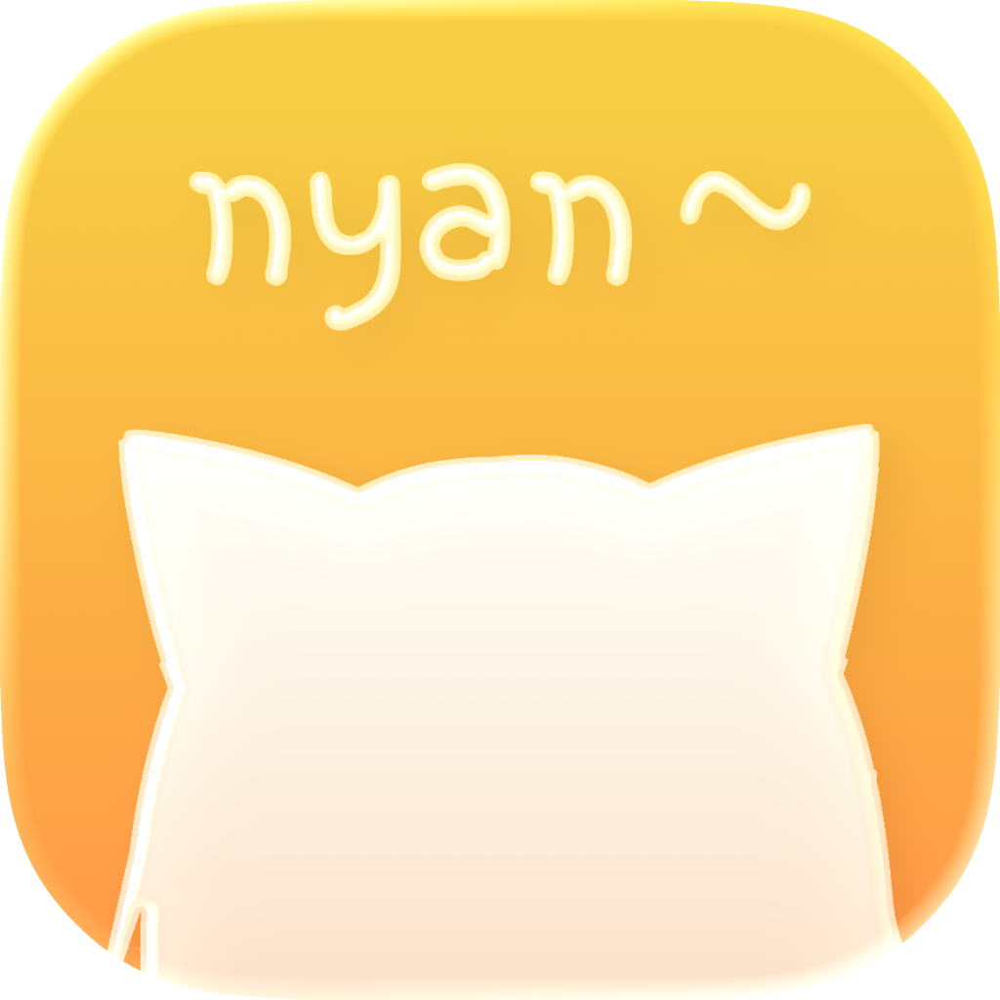
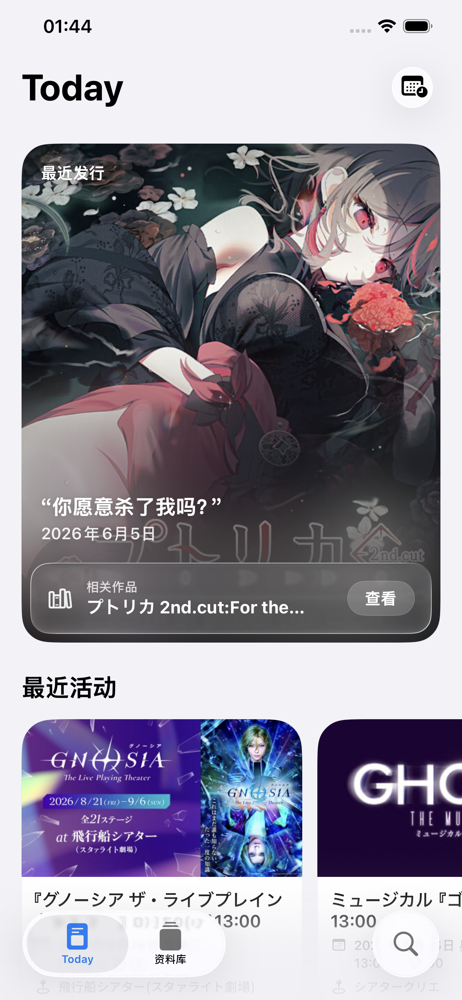
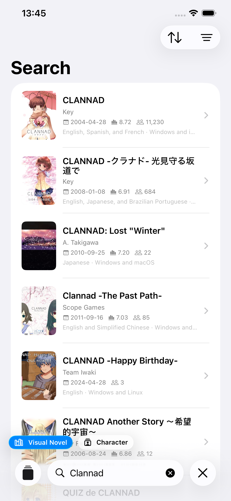
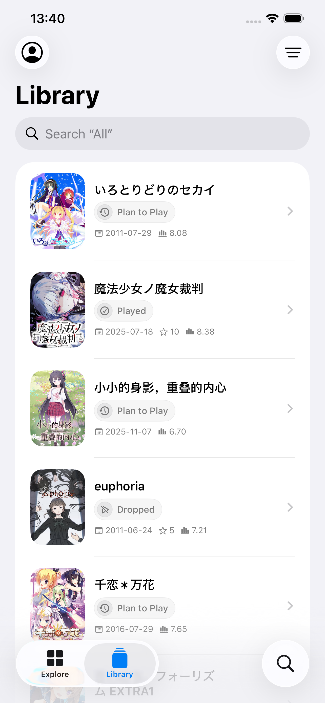
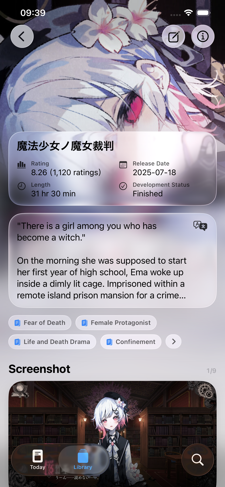

  <a href="./README.md">English</a> ·
  <a href="./README.zh-Hans.md">简体中文</a> ·
  <strong>繁體中文</strong> ·
  <a href="./README.ja.md">日本語</a> ·
  <a href="./README.ko.md">한국어</a>

<table>
  <tr>
    <td></td>
    <td width="32"></td>
    <td align="left">
      <h1>PaperVN</h1>
      
<strong>追蹤與探索視覺小說</strong>

    </td>
  </tr>
</table>

PaperVN 是一款專為 Apple 裝置打造的視覺小說輔助工具，協助你探索視覺小說、深入瞭解作品與角色，並記錄每一段遊玩旅程。無須登入即可瀏覽、探索與搜尋 VNDB 的公開資料。登入 VNDB 帳號後，還可以讀取及編輯個人資料庫。

## 預覽

  
  
  
  

Today · 搜尋 · 資料庫 · 視覺小說詳情

## 描述

### 輕輕地來

PaperVN 在製作過程中始終堅持「美觀優先」的原則。完全使用 SwiftUI 製作，每一處細節都經過仔細考量。

### Today

Today 每天都會展示一些值得關注的視覺小說與近期活動。同時，PaperVN 還能分析你的資料庫內容，並使用機器學習產生「為你推薦」列表。

### 資料庫

登入 VNDB 帳號後，你可以編輯資料庫、更新遊玩狀態、遊玩版本、評分，以及開始或結束日期。語言、外觀與內容安全等偏好也都可以自訂。

### 視覺小說／角色詳情

PaperVN 已為 VNDB 中 6,000 多個視覺小說標籤與角色特徵提供在地化，支援簡體中文、繁體中文、英文、日文與韓文。我們也正在為 VNDB 中超過 20 萬個視覺小說與角色簡介提供在地化支援。

### 搜尋

支援搜尋視覺小說、角色、發行版本、製作人員、開發商與發行商，並可使用符合條件的篩選方式進一步縮小結果範圍。

## 系統需求

需要執行 iOS 26 或更新版本的 iPhone，或執行 iPadOS 26 或更新版本的 iPad。

## 授權條款

除非另有說明，PaperVN 開發者提供的資料均為遵循 [CC0 1.0 通用授權條款](https://creativecommons.org/publicdomain/zero/1.0/deed.zh-hant)的自由內容。
